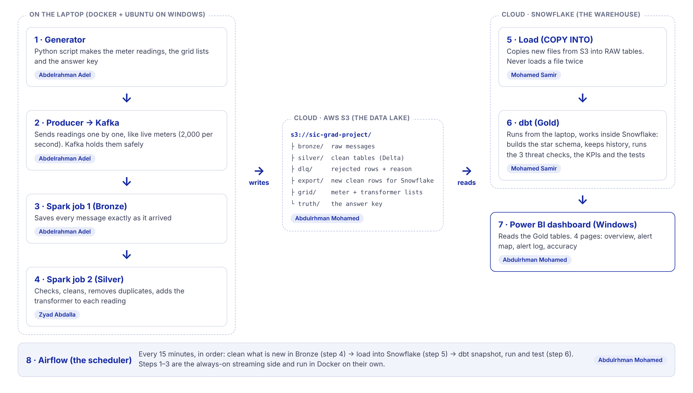
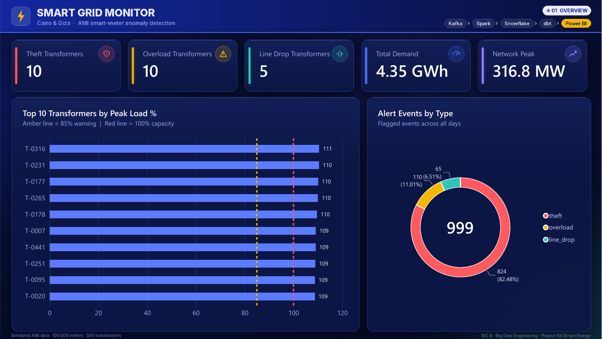
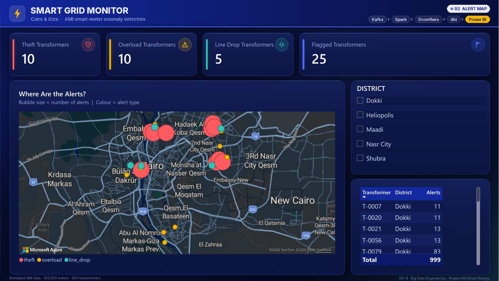

# Smart Grid Monitor

**A big-data pipeline that watches 100,000 smart electricity meters and flags three threats to the grid: electricity theft, transformer overload and line drop (low voltage).**

Graduation project · Samsung Innovation Campus (SIC 8) · Big Data Engineering · Project 04: Smart Energy



---

## What it does, in plain words

A city's electricity flows from substations to **transformers** (the boxes on the street), and from each transformer to about 200 homes and shops. Every home has a **smart meter** that reports its usage every 15 minutes. Each transformer reports what it sent out.

This project receives those readings as a live stream, cleans them, stores them in a cloud data lake and warehouse, runs three detection rules, and shows the results on a dashboard. A scheduler repeats the batch part by itself every 15 minutes.

Real meter data is private, so we wrote our own **simulator**. It builds a realistic grid in Cairo and Giza and secretly plants problems in the data. It also writes an **answer key** that the pipeline never sees. At the end we compare what the pipeline found with that key, so the accuracy is measured, not assumed.

## The three threats and how we catch them

| Threat | What happens in real life | The rule we use |
|---|---|---|
| **Electricity theft** | Someone tampers with their meter so it records less than they use | Over 4 hours, more than **11%** of the energy a transformer sent never shows up on its meters (6% is normal cable loss + 5% margin) |
| **Transformer overload** | Too many heavy loads at once (ACs on a hot evening); the transformer overheats | Load at or above **85%** of capacity for **2 readings** in a row (30 min) |
| **Line drop** | A weak or damaged line; voltage falls and appliances struggle | Voltage below **207 V** for **4 readings** in a row (1 hour) |

> Alerts point to patterns worth inspecting. They are not proof of wrongdoing.

## Results of the full run

| | |
|---|---|
| Meters / transformers simulated | 100,000 meters on 500 transformers, 5 districts |
| Messages streamed through Kafka | 9,649,221 meter + 48,000 transformer, **0 failed** |
| Clean meter readings in the warehouse | 9,591,495 (duplicates and broken messages removed) |
| Threats planted vs found | **25 planted, 25 found, 0 false alarms, 0 missed** (precision = recall = 100%) |
| Automation | Airflow: clean → load → snapshot → model → test, every 15 minutes |
| Data quality | 15 dbt tests passing, plus 1 test that fails on purpose to demo the quality gate |
| Speed | 24 hours of meter data streamed in about 80 minutes (2,000 readings/second) |

## How the data flows

```
simulator ──► Kafka ──► Spark job 1 ──► S3 bronze/   raw messages, untouched
                                            │
                          Spark job 2 ◄─────┘
                               ├──► S3 silver/  clean readings (Delta Lake)
                               ├──► S3 dlq/     rejected rows + the reason
                               └──► S3 export/  new clean rows for the warehouse
                                            │
                         COPY INTO ─────────┘──► Snowflake RAW
                                                     │
                                  dbt ──► snapshot (history) → star schema → 3 checks → KPIs → accuracy
                                                     │
                                               Power BI dashboard
```

| Layer | Where | What it holds |
|---|---|---|
| **Bronze** | S3 `bronze/` (Parquet) | Every Kafka message exactly as it arrived, with its topic, partition and offset |
| **Silver** | S3 `silver/` (Delta Lake) | Checked, de-duplicated readings, each meter linked to its transformer |
| **Gold** | Snowflake `MARTS` (built by dbt) | Star schema (2 facts, 2 dimensions), the alerts, KPIs and accuracy tables |

## Tech stack

| Tool | Used for |
|---|---|
| Python (NumPy) | The grid simulator and the Kafka producer |
| Apache Kafka 3.9 | The live message stream (two topics: meter and transformer readings) |
| Apache Spark 3.5 (PySpark, Structured Streaming) | Job 1: Kafka → Bronze. Job 2: Bronze → Silver, DLQ, export |
| Delta Lake 3.2 | Silver tables with ACID writes and MERGE (no duplicate readings) |
| AWS S3 | The data lake |
| Snowflake | The data warehouse |
| dbt | SQL models: SCD2 history, star schema, the three checks, KPIs, tests, lineage docs |
| Apache Airflow 2.10 | Runs the batch part every 15 minutes |
| Power BI | 4-page dashboard: Overview, Alert Map, Alert Log, Accuracy |
| Docker | Runs Kafka, Spark and the simulator on one laptop |

## Dashboard





## Repository structure

```
smart-grid-monitor/
├── README.md                  this page
├── RUN_GUIDE.md               step-by-step guide to run everything
├── config.yaml                simulator settings (size, days, planted problems, seed)
├── docker-compose.yml         Kafka, Spark job 1, Spark job 2 and the simulator
├── requirements.txt           Python libraries for the simulator image
├── .env.example               template for your AWS key (copy to .env)
│
├── simulator/
│   ├── generator.py           builds the grid, the readings and the answer key
│   ├── validate_outputs.py    checks the generated files before they are sent
│   └── producer.py            sends the readings to Kafka at a set speed
├── spark/
│   ├── bronze_ingest.py       Spark job 1: Kafka → S3 bronze/
│   └── silver_processing.py   Spark job 2: bronze/ → silver/ dlq/ export/
├── docker/                    one Dockerfile per image (simulator, bronze, silver)
├── scripts/
│   ├── run_stream.sh          smoke test, full-day stream, demo slots, status
│   └── reset_lake.sh          empties the S3 lake for a clean run
├── warehouse/                 Snowflake SQL: 01 setup, 02 reset, 03 load
├── dbt/                       dbt project: snapshot, models, tests
├── airflow/dags/              the Airflow DAG (smart_grid_pipeline)
├── powerbi/                   the Power BI report (.pbix)
└── docs/
    ├── Smart_Grid_Monitor_Technical_Documentation.pdf
    └── images/
```

## Quick start

You need: Windows with Ubuntu (WSL) or Linux, Docker, an AWS account, a Snowflake account, and Power BI Desktop for the dashboard.

```bash
git clone <this-repo-url> ~/smart-grid-monitor
cd ~/smart-grid-monitor
cp .env.example .env                         # add your AWS key and bucket
docker compose --profile tools --profile silver build
./scripts/run_stream.sh smoke                # 5-minute end-to-end test
```

Everything else (AWS and Snowflake setup, the full run, dbt, Airflow, Power BI) is in **[RUN_GUIDE.md](RUN_GUIDE.md)**.

## Documentation

The full technical documentation explains every phase, decision, schema, model, measure and result in plain language. You don't need an electricity background to follow it:
**[docs/Smart_Grid_Monitor_Technical_Documentation.pdf](docs/Smart_Grid_Monitor_Technical_Documentation.pdf)**

To browse the dbt models and their lineage graph:

```bash
cd dbt && dbt docs generate && dbt docs serve --port 8081
```

## Team

| Member | Role | Main work |
|---|---|---|
| **Abdelrahman Adel** | Data generation and streaming | Simulator and answer key, Kafka, the producer, Spark job 1 (Bronze), the run script |
| **Zyad Abdalla** | Distributed processing | Spark job 2: validation, dead-letter queue, de-duplication, enrichment, Delta Lake MERGE, export |
| **Mohamed Samir** | Warehouse and detection | Snowflake loading, the dbt project: SCD2 snapshot, star schema, the three checks, KPIs, accuracy, tests |
| **Abdulrhman Mohamed** | Cloud, integration, orchestration and serving | AWS and Snowflake setup, joining the parts end to end, Airflow, Power BI dashboard, documentation |

## Limitations

- The data is simulated. The rules are tuned to the simulator's patterns and would need tuning on real meter data.
- Processing runs on one laptop, so Silver lagged 10–20 minutes behind the stream (limited by upload speed). The same Spark code can run on a cloud cluster unchanged.
- The pipeline handles one city of 100,000 meters; a national grid would need a multi-broker Kafka cluster and a cloud Spark cluster.
